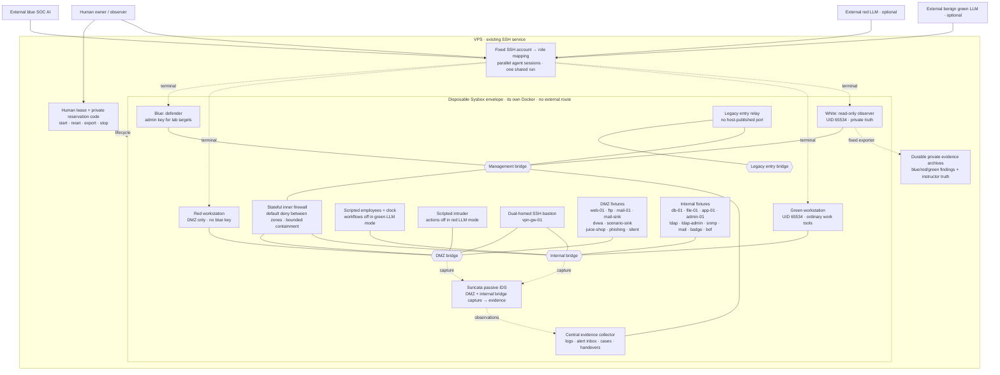

# Simulated environment

The diagram shows the full encapsulated runtime. Its generated corporate overlay
adds routing policy and the IDS to the development Compose fixtures.
Dotted arrows are terminal/control paths through the VPS portal, not exposed
service ports. Models run outside the range. The human chooses both traffic modes.

The three main zones are management, DMZ and internal. Blue and telemetry are
management-only; employees and green are internal-only; red is DMZ-only. The
intentional dual-homed SSH bastion remains a scenario pivot. Other cross-zone
traffic uses the inner Docker bridge gateways and a stateful firewall: blue and
telemetry can manage lab targets, DVWA can reach its database, and internal users
can reach the lab's public web/mail/FTP/DNS services. Other cross-zone requests
are dropped. The small internal LAN is not microsegmented.

Suricata captures the two workload bridges in the **inner system container's
network namespace**, with no VPS interfaces, Docker socket or host-published
listener. Namespace and route checks reject running these controls on a normal
host. Development Compose smoke tests omit this inner-only overlay.

No target service or evidence API is published on the VPS host. The host Docker
socket is absent from agent workstations. Blue has lab administration access;
red and green have no blue key or instructor journal. White normally runs with
no effective capabilities and read-only mounts. A fixed root export process can
read private findings from the different lab UIDs; downloads go to the human.

There are **29 containers**. The table below is derived from the full runtime Compose
configuration; groups in the diagram combine individual fixtures for readability.

| Container | Compose networks |
| --- | --- |
| `activity` | internal |
| `admin-01` | internal |
| `app-01` | internal |
| `badge` | internal |
| `bof` | internal |
| `db-01` | internal |
| `defender` | management |
| `dvwa` | dmz |
| `entry` | entry, management |
| `file-01` | internal |
| `ftp` | dmz |
| `green` | internal |
| `ids` | inner system container namespace; passive bridge capture |
| `juice-shop` | dmz |
| `ldap` | internal |
| `ldap-admin` | internal |
| `mail` | internal |
| `mail-01` | dmz |
| `mail-sink` | dmz |
| `phishing` | dmz |
| `red` | dmz |
| `scenario-runner` | dmz |
| `scenario-sink` | dmz |
| `silent` | dmz |
| `snmp` | internal |
| `telemetry` | management |
| `vpn-gw-01` | dmz, internal |
| `web-01` | dmz |
| `white` | management |
