# Simulated environment

The diagram shows the implemented Compose networks and role workstations.
Dotted arrows are terminal/control paths through the VPS portal, not exposed
service ports. Models run outside the range. The human chooses both traffic modes.

```mermaid
flowchart TB
  human["Human owner / observer"]
  blueModel["External blue SOC AI"]
  redModel["External red LLM · optional"]
  greenModel["External benign green LLM · optional"]

  subgraph VPS["VPS · existing SSH service"]
    gate["Human lease + private control token<br/>start · reset · export · stop"]
    portals["Fixed SSH account → role mapping<br/>parallel agent sessions · one shared run"]
    archives["Durable private evidence archives<br/>blue/red/green findings + instructor truth"]

    subgraph Envelope["Disposable Sysbox envelope · its own Docker · no external route"]
      mgmt{{"Management bridge"}}
      dmz{{"DMZ bridge"}}
      internal{{"Internal bridge"}}
      entrynet{{"Legacy entry bridge"}}

      blue["Blue: defender<br/>admin key for lab targets"]
      white["White: read-only observer<br/>UID 65534 · private truth"]
      red["Red workstation<br/>DMZ only · no blue key"]
      green["Green workstation<br/>UID 65534 · ordinary work tools"]
      sensor["Central evidence collector<br/>public observations · HTTP/cursor feed"]
      employees["Scripted employees + clock<br/>workflows off in green LLM mode"]
      actor["Scripted intruder<br/>actions off in red LLM mode"]
      shared["Dual-homed fixtures<br/>vpn-gw-01 · dvwa · scenario-sink"]
      dmzServices["DMZ fixtures<br/>web-01 · ftp · mail-01 · mail-sink<br/>juice-shop · phishing · silent"]
      internalServices["Internal fixtures<br/>db-01 · file-01 · app-01 · admin-01<br/>ldap · ldap-admin · snmp · mail · badge · bof"]
      relay["Legacy entry relay<br/>no host-published port"]

      blue --- mgmt
      blue --- dmz
      blue --- internal
      white --- mgmt
      sensor --- mgmt
      sensor --- dmz
      sensor --- internal
      red --- dmz
      green --- dmz
      green --- internal
      employees --- dmz
      employees --- internal
      actor --- dmz
      shared --- dmz
      shared --- internal
      dmzServices --- dmz
      internalServices --- internal
      relay --- entrynet
      relay --- mgmt
    end

    portals -. terminal .-> blue
    portals -. terminal .-> red
    portals -. terminal .-> green
    portals -. terminal .-> white
    gate -. lifecycle .-> Envelope
    white -. fixed exporter .-> archives
  end

  human --> gate
  human --> portals
  blueModel --> portals
  redModel --> portals
  greenModel --> portals
```

The three main service zones are management, DMZ and internal. The legacy
unpublished relay also has an entry bridge. Blue, telemetry and scripted normal
users span multiple networks; green spans DMZ/internal. The gateway, DVWA and
scenario sink are dual-homed. These are shared bridges, not a strict firewall
policy forcing every cross-zone path through one router. The scripted intruder
is DMZ-only and its fixed internal actions traverse the gateway.

No target service or evidence API is published on the VPS host. The host Docker
socket is absent from agent workstations. Blue has lab administration access;
red and green have no blue key or instructor journal. White normally runs with
no effective capabilities and read-only mounts. A fixed root export process can
read private findings from the different lab UIDs; downloads go to the human.

There are **28 containers**. The table below is derived from the resolved Compose
configuration; groups in the diagram combine individual fixtures for readability.

| Container | Compose networks |
| --- | --- |
| `activity` | dmz, internal |
| `admin-01` | internal |
| `app-01` | internal |
| `badge` | internal |
| `bof` | internal |
| `db-01` | internal |
| `defender` | dmz, internal, management |
| `dvwa` | dmz, internal |
| `entry` | entry, management |
| `file-01` | internal |
| `ftp` | dmz |
| `green` | dmz, internal |
| `juice-shop` | dmz |
| `ldap` | internal |
| `ldap-admin` | internal |
| `mail` | internal |
| `mail-01` | dmz |
| `mail-sink` | dmz |
| `phishing` | dmz |
| `red` | dmz |
| `scenario-runner` | dmz |
| `scenario-sink` | dmz, internal |
| `silent` | dmz |
| `snmp` | internal |
| `telemetry` | dmz, internal, management |
| `vpn-gw-01` | dmz, internal |
| `web-01` | dmz |
| `white` | management |
